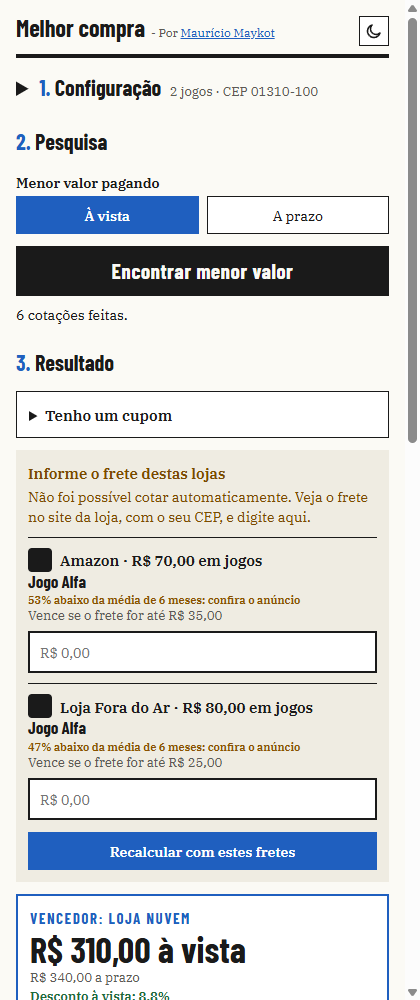
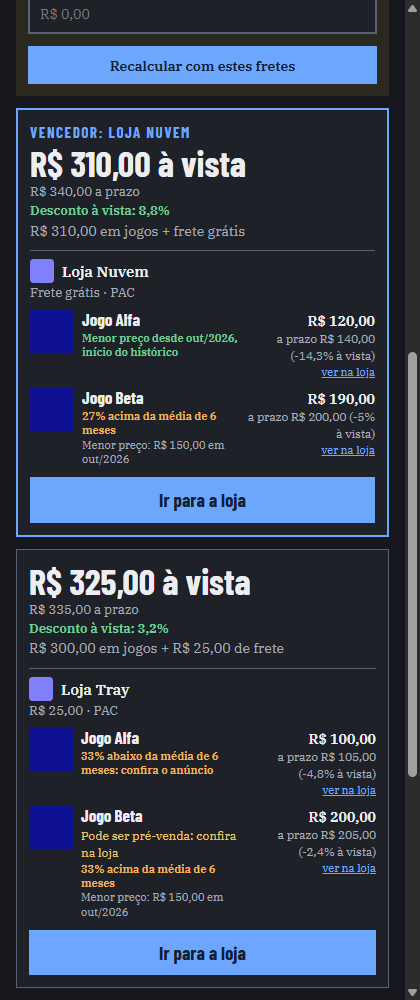
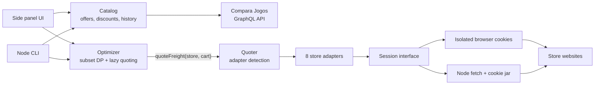

# Best Price Board Game Extension

A Chrome extension that finds the **cheapest real combination of store carts** for a list of board games in Brazil, including the actual shipping quote from each store for the buyer's ZIP code.

Price comparison sites show the lowest price per game. That is not the lowest total: shipping is unified per store, free-shipping thresholds change with the cart, and splitting an order can cost more than it saves. The only way to know is to ask each store what a specific cart costs, and there is no shared API for that. This project builds the integration layer that makes the question answerable.

<p>
  
  
</p>

<sub>Screenshots from the offline test suite, so stores and prices are simulated. The UI is in Brazilian Portuguese.</sub>

## What it does

- Reads games from open Compara Jogos tabs, a link, or a name search.
- Collects every new offer from the [Compara Jogos](https://www.comparajogos.com.br) GraphQL API, including offers the site hides behind "show more".
- Quotes shipping for real carts on 8 storefront platforms and picks the lowest total, for cash or installment payment.
- Streams results while it searches, and can be cancelled at any point.
- Applies per-store coupons to products only, and flags prices against up to 5 years of price history.
- Fills the winning cart in the user's own session, so checkout continues on the store's site.
- Asks the user for shipping when a store cannot be quoted automatically, then shows the maximum shipping at which that store would still win.

## Architecture



The core has no Chrome dependency. The same optimizer and adapters run in the side panel and in the CLI, and only the `session` object changes. There are no runtime or build dependencies: it is plain JavaScript loaded directly by Chrome.

## Engineering highlights

### Optimizing when every data point is a network call

Each shipping quote means loading pages and building a cart on a live store, so quoting every possible cart is not an option. Shipping is treated as a black box, which keeps unified freight, free-shipping thresholds and shipping discounts out of the algorithm: only the real quote matters.

[`optimizer.js`](src/optimizer/optimizer.js) runs a dynamic program over game subsets, with at most one cart per store:

1. Carts not yet quoted count as free shipping, which is a lower bound.
2. It computes the best plans under those bounds.
3. It quotes only the carts in those plans, then repeats.

When the top plans contain only quoted carts, no other plan can beat them, because even their lowest possible cost is higher. A randomized test compares the result against brute force on generated scenarios.

### One contract over inconsistent systems

Stores run on different platforms with no common interface, so each adapter in [`src/freight/`](src/freight/) implements the same small contract: `parseProduct(html)`, `quoteCart(origin, products, zipCode, session)`, and optionally `addToCart` and `applyCoupon`. The quoter detects the platform from the product page.

| Adapter | Platform | How a quote works |
| --- | --- | --- |
| `tray` | Tray | Cart session, then shipping endpoint |
| `nuvemshop` | Nuvemshop | Adds items, then posts the ZIP code |
| `lojaIntegrada` | Loja Integrada | Cart plus address endpoint |
| `bravo` | Simplo7 | Quotes without a cart, because carts reserve stock |
| `brecho` | WooCommerce | Cart page and shipping form with nonce |
| `meca` | iSET | Direct quote endpoint, no cart |
| `paladins` | CommercePlus | Quotes, then removes the items it added |
| `pira` | Custom tRPC | Shipping simulator endpoint |

Each store's data also needed normalizing. For example, delivery lists include free pickup and "add to a previous order" options that look like R$ 0 shipping. [`delivery.js`](src/freight/delivery.js) filters those out so they can't win a comparison.

### Managing state on a system you don't own

In the browser, requests carry the user's cookies, so a naive quote would overwrite their real carts. [`isolatedSession.js`](src/extension/isolatedSession.js) handles this per domain:

1. Snapshot the store's cookies and persist the copy to session storage.
2. Clear them and quote in an anonymous session.
3. Restore them, even when the quote fails.

Quotes for one domain are queued, while different domains run in parallel. If the panel closes mid-quote, the next launch repairs the cookies from the snapshot. Snapshot writes are serialized because concurrent writes could overwrite each other and later restore stale cookies.

### Automating responsibly

Automation has real effects on the systems it touches, and this project keeps those limits explicit:

- **No orders are created.** Quote carts are anonymous and abandoned.
- **Stock matters.** Testing showed that one platform reserves real stock when an item enters a cart, so its adapter now quotes without creating one.
- **Refusals are respected.** Amazon disallows automation in `robots.txt` and Mercado Livre responds with a CAPTCHA, so the extension sends them no automated requests and uses manual shipping input instead.
- **Protections are not bypassed.** Where a coupon requires a store's anti-fraud identity check, the extension shows the code for the user to copy.

### Tests that don't touch production sites

Testing against live stores is slow and has side effects, so daily testing is fully offline:

- `npm test` runs 217 unit tests with store responses as fixtures.
- `npm run test:chrome` runs 53 checks against the real extension in headless Chrome. Every request is intercepted through the DevTools Protocol, and any unexpected URL fails the run, which also proves that manual-only stores receive no automatic requests.

Network calls have timeouts (GraphQL 15s, store sessions 20s), and a failed store becomes a manual input instead of failing the search.

## Getting started

Requires Node.js 20+ for the tests and CLI, and Chrome 116+ for the extension. There is nothing to install.

**Extension**

1. Open `chrome://extensions` and enable **Developer mode**.
2. Click **Load unpacked** and select this folder.
3. Click the extension icon to open the side panel.

**Tests**

```bash
npm test
npm run test:chrome   # outside Windows, set CHROME_PATH to the Chrome binary
```

**CLI** (makes real requests to stores)

```bash
npm run quote -- 01310100 compile-main-1 ruins
npm run quote -- 01310100 compile-main-1 ruins --a-prazo   # installment prices
```

## Known limitations

- Automatic coupon application has not been tested with a valid coupon.
- Filling carts on real stores has been verified on Nuvemshop and Tray only. Other adapters are covered by fixtures.
- Multi-item quotes on the tRPC store come from its simulator.
- "Installment" means the list price from Compara Jogos, which may differ from the store's checkout.
- Free shipping tied to Pix payment was not confirmed at checkout.
- Adapters depend on undocumented store behavior, so a storefront change can break one. The search then falls back to manual shipping for that store.
- Delivery time is not considered yet: the priority is the lowest total.

## Built with AI assistance

Developed with [Claude Code](https://claude.com/claude-code) as a pair programmer, as the commit trailers show. The extension itself does not call any LLM.

## License

[MIT](LICENSE). Bundled fonts (Barlow Condensed and IBM Plex Serif) are under the [SIL Open Font License](panel/fonts/).
